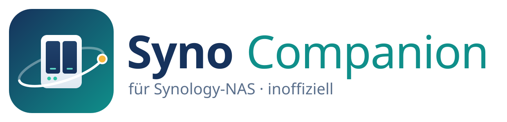

# Syno Companion

<p align="center">
  <picture>
    <source media="(prefers-color-scheme: dark)" srcset="assets/branding/logo-dark.de.svg">
    
  </picture>
</p>

> Deutsche Fassung. Englisches Original: [README.md](README.md)

**Syno Companion** ist eine freie Open-Source-Desktop-App für **Synology-NAS** unter **Linux, macOS und Windows**. Sie bringt auf den Desktop, was Synology auf dem Handy anbietet (DS finder, DS file, DS get), und schließt die Lücken, die DSM offen lässt: Festplatten von Drittanbietern, Community-Pakete, Komponenten-Updates und Einstellungen, die DSM nicht anbietet oder bei jedem Update zurücksetzt.

Sie ist für **normale Benutzer ohne Shell-Erfahrung** gedacht. Alles, was über DSM hinaus ins System eingreift, liegt hinter einem **Expertenmodus**, zeigt vorher die genauen Befehle, legt zuerst eine Sicherung an und lässt sich rückgängig machen.

> **Stand: Pre-Alpha, Version 0.1.** NAS finden, Ersteinrichtung, Anmeldung (mit 2FA und Zertifikatsprüfung) und Übersicht funktionieren und sind an einem Virtual DSM 7.4.1 getestet. Downloads: [Releases](https://github.com/SoulInfernoDE/synology-companion-app/releases). Siehe [Roadmap](ROADMAP.de.md).
>
> Syno Companion ist ein unabhängiges Community-Projekt. Es steht in keiner Verbindung zu Synology Inc. und wird von Synology weder unterstützt noch empfohlen. „Synology“ und „DSM“ sind Marken der Synology Inc.

## Geplante Funktionen

**Alltag (ohne Expertenmodus)**

- **Finden und verbinden:** NAS im lokalen Netz werden automatisch gefunden, über Bonjour und die Suche des Synology Assistant; Anmeldung mit Zwei-Faktor-Anmeldung, Gerät merken, mehrere NAS nebeneinander. Zugangsdaten landen im Schlüsselbund des Systems.
- **Ersteinrichtung:** Ein neues NAS, dessen DSM-Willkommensassistent noch nicht gelaufen ist, wird aus der App eingerichtet: eigenes Administratorkonto, eingebautes Konto `admin` gesperrt, Gerätename, Zeitzone und Updates; Nutzungsstatistiken bleiben aus. Bis dahin darf jeder im Netzwerk das NAS verwalten, deshalb warnt die App davor.
- **Übersicht:** CPU, Arbeitsspeicher, Netzwerk, Volumes und ihre Belegung, Zustand und Temperatur der Festplatten, Laufzeit, verfügbare DSM- und Paket-Updates.
- **Tray und Benachrichtigungen:** herabgestuftes Volume, fehlgeschlagene Sicherung, Festplattenwarnungen, neue Updates.
- **Steuerung:** Wake-on-LAN, Neustart, Herunterfahren, Piepton abschalten.
- **Freigaben mit einem Klick:** im Dateimanager eingebunden (Nemo/Nautilus/Dolphin, Finder, Explorer).
- **Download Station:** Links, Torrent-Dateien und `magnet:`-Links übergeben.
- **SSH leicht gemacht:** Die App schaltet SSH auf Wunsch ein, erzeugt einen Schlüssel (oder nimmt deinen), hinterlegt ihn auf dem NAS mit den Rechten, die DSM erwartet, und merkt sich den Host-Schlüssel. Danach arbeitet sie ohne Passwortabfrage auf dem NAS; `sudo`-Passwörter bleiben im Schlüsselbund und stehen nie in einer Befehlszeile.
- **Paketquellen:** Community-Quellen wie [SynoCommunity](https://synocommunity.com) hinzufügen und deren Pakete durchsuchen.

**Expertenmodus**

- **Festplatten von Drittanbietern:** HDDs, SSDs und NVMe-Laufwerke hinzufügen, die nicht in Synologys Kompatibilitätsdatenbank stehen, auf Basis von [007revad/Synology_HDD_db](https://github.com/007revad/Synology_HDD_db).
- **Erweiterungskatalog:** Community-Skripte von GitHub als _Rezepte_: feste Version mit Prüfsumme, Vorschau jedes Befehls, Sicherung, Anwenden, Prüfen, Rückgängig.
- **Komponenten-Updates:** Container-Images aktualisieren; die Docker-Engine von Container Manager über die von Synology ausgelieferte Version hinaus aktualisieren.
- **Nach einem DSM-Update:** Die App erkennt die neue DSM-Version und bietet an, alle Anpassungen, die das Update entfernt hat, in einem Schritt wieder einzuspielen.
- **Speichertest** wie im Synology Assistant (Recherche, siehe Roadmap).
- **Systemdiagnose:** Kernel-Version und Kernel-Funktionen wie `io_uring`.

**Nextcloud (v1.x)**

Ein eigener Tab für Nextcloud auf Web Station: prüfen, welche MariaDB-, Redis- und PHP-Versionen das NAS anbieten kann und was das nächste Nextcloud-Release braucht, Snapshot und Datenbank-Dump anlegen, Rechte öffnen, Updater laufen lassen, `occ upgrade` ausführen, Rechte wieder schließen. Ein Knopf statt eines Abends voller Shell-Befehle.

**v2.0**

- **Web-Station-Einstellungen, die DSM-Updates überstehen:** PHP-Werte und -Module (zum Beispiel `redis` für Nextcloud) je Profil, nach jedem Update automatisch wieder eingespielt.

**Eigenes Projekt**

- Eine Cross-Compiler-Toolchain, um aktuelle Kernel von kernel.org auf Synology-Modelle zurückzuportieren, mit einem Ausweich-Kernel, damit ein fehlgeschlagenes Update das NAS nicht unbootbar macht. Das braucht zuerst Recherche; siehe [Roadmap](ROADMAP.de.md#eigenes-projekt-kernel-toolchain).

## Aussehen

Die App hat **Skins** für Linux, macOS und Windows, jeweils hell und dunkel. Sie wählt den Skin des Systems, auf dem sie läuft, und folgt der Hell/Dunkel-Einstellung; beides lässt sich in den Einstellungen auch von Hand wählen.

## Plattformen und Pakete

| System                       | Pakete                                                                                            |
| ---------------------------- | ------------------------------------------------------------------------------------------------- |
| Linux (x86_64, arm64)        | `.deb` (Debian, Ubuntu, Linux Mint), `.rpm` (Fedora, openSUSE), AppImage; Flatpak und AUR geplant |
| macOS (Apple Silicon, Intel) | `.dmg`                                                                                            |
| Windows 10/11                | `.msi`, Setup-`.exe`                                                                              |

Unterstützte NAS: DSM 7.3 und neuer. Ältere DSM-7-Versionen können für die Grundfunktionen funktionieren.

## Sicherheitsregeln

1. **Nichts ändert sich ohne Nachfrage.** Jede Änderung zeigt, was auf welchem NAS als welcher Benutzer ausgeführt wird.
2. **Erst sichern.** Dateien werden vor dem Bearbeiten kopiert; wo möglich wird ein Btrfs-Snapshot angelegt.
3. **Rückgängig.** Jedes Rezept hat einen Wiederherstellungsschritt, und die App führt ein Protokoll über alles, was sie geändert hat.
4. **Keine Geheimnisse in Befehlszeilen oder Logs.**
5. **Entwickeln und testen auf einem virtuellen DSM, nicht auf dem produktiven NAS.** Siehe [docs/test-environment.de.md](docs/test-environment.de.md).

## Bauen

Voraussetzungen: Rust 1.99+, Node.js 24+ und die [Systemabhängigkeiten von Tauri 2](https://tauri.app/start/prerequisites/).

```bash
npm install
npm run app:dev
```

`npm run dev` startet nur die Oberfläche im Browser, mit Demodaten statt eines NAS; `/?mock` ergänzt einen Ersatz für die Anmeldung ([Testumgebung](docs/test-environment.de.md)). `cargo test` führt die Tests der Rust-Crates aus.

Mehr: [Architektur](docs/architecture.de.md) · [Testumgebung](docs/test-environment.de.md) · [Releases](docs/releasing.de.md) · [Roadmap](ROADMAP.de.md)

## Lizenz

[GPL-3.0-or-later](LICENSE). Community-Skripte, die Rezepte nutzen, behalten ihre eigenen Lizenzen; sie werden aus den Repositories ihrer Autoren geladen, nicht mitgeliefert.
