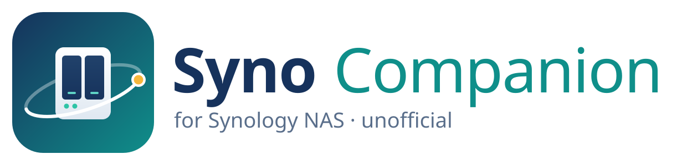

# Syno Companion

<p align="center">
  <picture>
    <source media="(prefers-color-scheme: dark)" srcset="assets/branding/logo-dark.svg">
    
  </picture>
</p>

> English original. German version: [README.de.md](README.de.md)

**Syno Companion** is a free, open-source desktop app for **Synology NAS** on **Linux, macOS and Windows**. It brings what Synology offers on phones (DS finder, DS file, DS get) to the desktop, and closes the gaps that DSM leaves open: third-party drives, community packages, component updates and settings that DSM does not expose or resets with every update.

It is made for **regular users without shell experience**. Everything that touches the system beyond what DSM offers sits behind an **expert mode**, shows the exact commands before it runs them, makes a backup first and can be undone.

> **Status: everything planned for 1.0 is on the main branch; the latest published release is 0.2.** The basics are tested against a Virtual DSM; packages, containers, recipes and Nextcloud are tested against a stand-in DSM and still need testing on real hardware. Downloads: [releases](https://github.com/SoulInfernoDE/synology-companion-app/releases). See the [roadmap](ROADMAP.md).
>
> Syno Companion is an independent community project. It is not affiliated with, endorsed by or supported by Synology Inc. "Synology" and "DSM" are trademarks of Synology Inc.

## Features

**Everyday (no expert mode needed)**

- **Find and connect:** NAS on the local network are found automatically, through Bonjour and Synology Assistant's own search; sign in with two-factor authentication, remember the device, several NAS side by side. Credentials go to the system keychain.
- **First-time setup:** a new NAS whose DSM welcome wizard has not run is set up from the app: your own administrator account, the built-in `admin` account locked, device name, time zone and updates; usage statistics stay off. Until then, DSM lets anyone on the network manage the NAS, so the app warns about it.
- **Dashboard:** CPU, memory, network, volumes and their usage, drive health and temperature, uptime, available DSM and package updates.
- **Tray and notifications:** degraded volume, failed backup, drive warnings, new updates.
- **Control:** Wake-on-LAN, restart, shut down, silence the beeper.
- **Shared folders with one click:** mounted in the file manager (Nemo/Nautilus/Dolphin, Finder, Explorer).
- **Download Station:** follow downloads, add HTTP, FTP and `magnet:` links, pause, resume and remove them.
- **SSH made easy:** the app enables SSH on request, creates a key of its own for this computer, installs it on the NAS with the permissions sshd expects and pins the host key. Afterwards it works on the NAS without asking for a password; `sudo` passwords stay in the keychain and are never passed on a command line. Diagnostics show what DSM hides (kernel, `io_uring`, memory modules, network drivers), and expert mode adds a terminal.
- **Packages:** install and update packages from Synology and from community sources such as [SynoCommunity](https://synocommunity.com), with the packages they depend on.
- **Containers:** see which containers of Container Manager run an older image than their tag offers, and update Compose projects.

**Expert mode**

- **Third-party drives:** add HDDs, SSDs and NVMe drives that are not in Synology's compatibility database, based on [007revad/Synology_HDD_db](https://github.com/007revad/Synology_HDD_db).
- **Extension catalog:** community scripts from GitHub as _recipes_: pinned version and checksum, preview of every command, backup, apply, check, undo.
- **After a DSM update:** the app notices the new DSM version and offers to re-apply every recipe the update removed, with the options of the last run; an optional boot task on the NAS does it without the app.
- **Journal:** every recipe run is written to a journal on the NAS, exportable as JSON.

**Nextcloud**

A dedicated tab for Nextcloud on Web Station: it shows the version, PHP, database and Redis, checks the PHP version against what the next Nextcloud release needs, and updates in visible steps: database dump, maintenance mode, open the permissions, Nextcloud's updater, `occ upgrade`, missing indices, close the permissions again. Each step can be followed and resumed. One button instead of an evening of shell commands.

**Not yet**

- Updating Container Manager's Docker engine: there is no maintained script for current Container Manager versions yet.
- Starting the memory test from the app: the app shows the results of Synology Assistant's test; starting it needs research on real hardware.

**v2.0**

- **Web Station settings that survive DSM updates:** PHP values and modules (for example `redis` for Nextcloud) per profile, re-applied automatically after each update.

**Separate project**

- A cross-compiler toolchain to backport current kernel.org kernels to Synology models, with a fallback kernel so a broken update does not leave the NAS unbootable. This needs research first; see [roadmap](ROADMAP.md#separate-project-kernel-toolchain).

## Look

The app has **skins** for Linux, macOS and Windows, each in light and dark. It picks the skin of the system it runs on and follows the light/dark setting; both can be chosen manually in the settings.

## Platforms and packages

| System                       | Packages                                                                                           |
| ---------------------------- | -------------------------------------------------------------------------------------------------- |
| Linux (x86_64, arm64)        | `.deb` (Debian, Ubuntu, Linux Mint), `.rpm` (Fedora, openSUSE), AppImage; Flatpak and AUR prepared |
| macOS (Apple silicon, Intel) | `.dmg`                                                                                             |
| Windows 10/11                | `.msi`, setup `.exe`                                                                               |

Supported NAS: DSM 7.3 and newer. Older DSM 7 versions may work for the basic features.

## Safety rules

1. **Nothing changes without asking.** Every change shows what will run, on which NAS, as which user.
2. **Backup first.** Files are copied before they are edited; where possible a Btrfs snapshot is taken.
3. **Undo.** Every recipe has a restore step, and the app keeps a journal of what it changed.
4. **No secrets on command lines or in logs.**
5. **Develop and test on a virtual DSM, not on your production NAS.** See [docs/test-environment.md](docs/test-environment.md).

## Building

Requirements: Rust 1.99+, Node.js 24+ and the [Tauri 2 system dependencies](https://tauri.app/start/prerequisites/).

```bash
npm install
npm run app:dev
```

`npm run dev` starts the user interface alone in the browser, with demo data instead of a NAS; `/?mock` adds a stand-in for the sign-in. `cargo run -p companion-mockdsm` starts a stand-in DSM for the real app ([test environment](docs/test-environment.md)). `cargo test` runs the tests of the Rust crates.

More: [architecture](docs/architecture.md) · [test environment](docs/test-environment.md) · [releasing](docs/releasing.md) · [roadmap](ROADMAP.md)

## License

[GPL-3.0-or-later](LICENSE). Community scripts used by recipes keep their own licenses; they are downloaded from their authors' repositories, not bundled.
